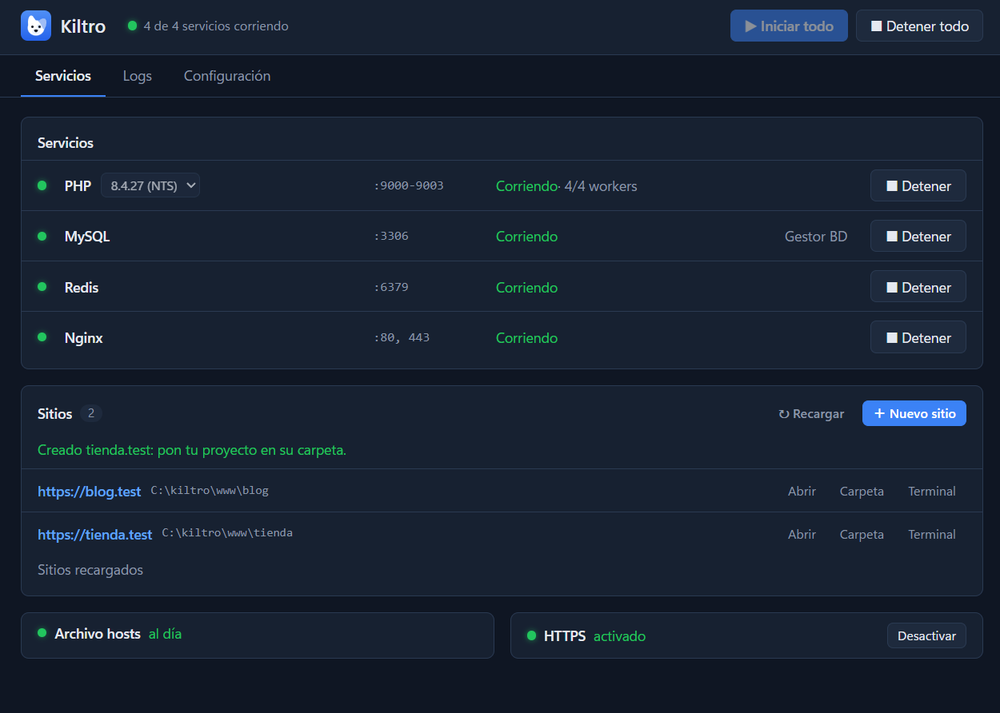
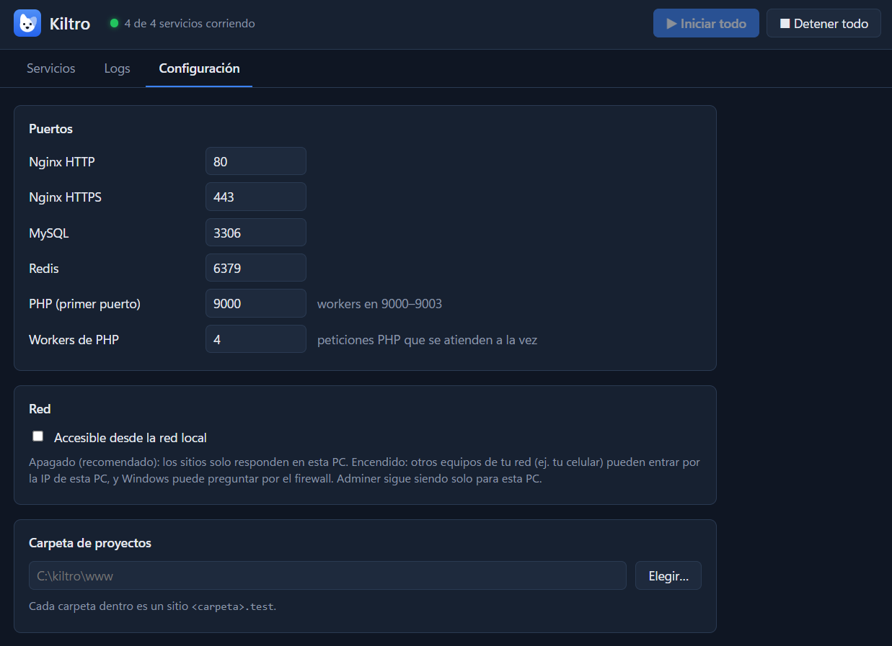
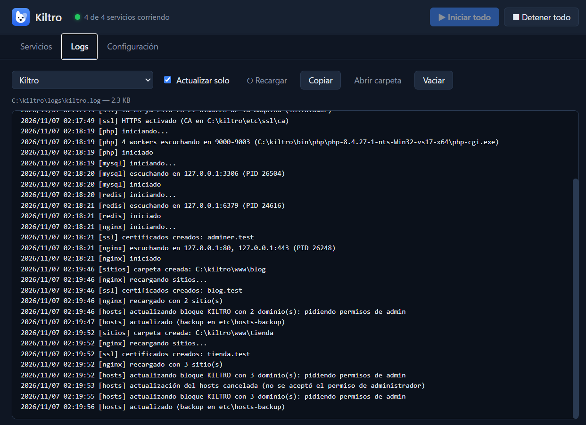
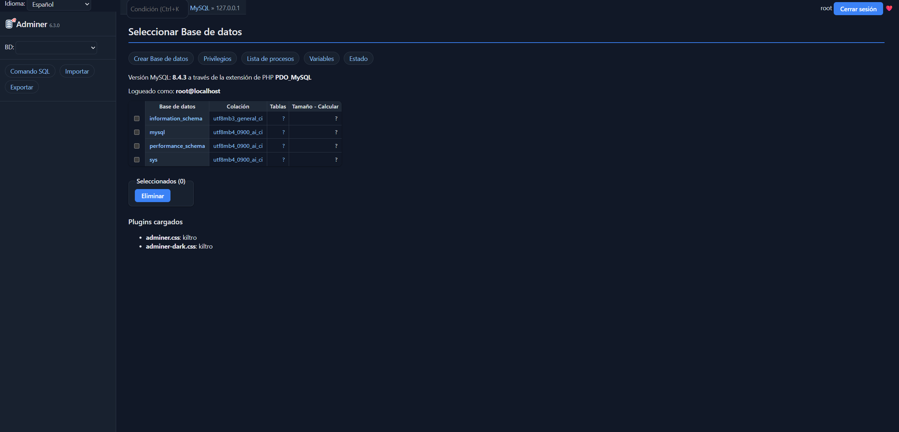

<p align="center">
  
</p>

<h1 align="center">Kiltro</h1>

<p align="center">
  <strong>Your local PHP environment on Windows: lightweight, portable and hassle-free.</strong><br>
  Nginx, PHP, MySQL and Redis ready in one click, with an <code>https://project.test</code> site for every folder.
</p>

<p align="center">
  <a href="https://github.com/Cashupin/kiltro/releases/latest"></a>
  
  <a href="LICENSE"></a>
</p>

<p align="center">
  <a href="https://github.com/Cashupin/kiltro/releases/latest"><strong>Download</strong></a> ·
  <a href="#getting-started">Getting started</a> ·
  <a href="#faq">FAQ</a> ·
  <a href="README.md">Español</a>
</p>

<p align="center">
  
</p>

> The app itself is in Spanish for now. An English interface is on the wish list.

---

## Why Kiltro?

A *quiltro* is a Chilean mixed-breed dog: no pedigree, but loyal, light on its feet and able to
get by anywhere. Kiltro is that for your PC.

- **Truly lightweight.** No Docker, no virtual machines, no Windows services installed. Services
  run only when you start them and stop with Kiltro. Runs fine on low-RAM PCs.
- **One site per folder.** Create `www\my-shop` and you get `http://my-shop.test`. Laravel
  projects are detected and served from `public/`.
- **Local HTTPS in one click.** Valid certificates for `https://*.test`, with the padlock in
  Chrome, Edge and Firefox.
- **Switch PHP versions** from a dropdown. Each version keeps its own `php.ini`.
- **`php` and `composer` in any terminal**, always using the version selected in Kiltro.
- **Built-in database manager** (Adminer, with its own theme) one click away.
- **Doesn't run as administrator.** It only asks for permission (UAC) to update the `hosts`
  file when your domains change.
- **Portable.** Everything lives in one folder: settings, databases, logs and projects.
- **Free and open source** (GPL-3.0).

## What's included

| | Version |
|---|---|
| Nginx | 1.30.4 |
| PHP (NTS) | 8.4.27 — you can add more versions |
| MySQL Community | 8.4.3 LTS |
| Redis (Windows port) | 5.0.14.1 |
| Composer | 2.10.2 |
| Adminer | 6.3.0 |
| mkcert (local HTTPS) | 1.4.4 |

Unmodified and under their original licenses (see [THIRD-PARTY-NOTICES.md](THIRD-PARTY-NOTICES.md)).

## Installation

1. Download **`kiltro-setup-<version>.exe`** from [Releases](https://github.com/Cashupin/kiltro/releases/latest).
2. Run it. It installs to `C:\kiltro` (Kiltro needs to write to its own folder, so it doesn't
   go in "Program Files").
3. Open Kiltro from the Start menu.

> **"Windows protected your PC"?** The installer isn't digitally signed yet (signing costs
> money and Kiltro is a personal project). Click **More info → Run anyway**. You can check the
> file is the original one with `SHA256SUMS.txt`, next to the download.

**Portable version:** download `kiltro-portable-<version>.zip`, extract it to a folder of your
own (e.g. `C:\kiltro`) and open `kiltro.exe`. Works the same, nothing to install.

Requirements: 64-bit Windows 10 or 11. About 400 MB once installed.

## Getting started

1. Click **▶ Iniciar todo** (Start all).
2. Click **＋ Nuevo sitio** (New site), type a name (e.g. `blog`) and you're done: `http://blog.test`.
3. Put your project in that folder. For a fresh Laravel app, click **Terminal** on the site
   and run:

   ```bash
   composer create-project laravel/laravel .
   ```

   (First enable `php` and `composer` in **Configuración → php y composer en la terminal**.)
4. Need a database? MySQL is at `127.0.0.1:3306`, user `root` with no password (what Laravel's
   default `.env` expects). The **Gestor BD** button opens Adminer.
5. Want HTTPS? Click **Activar HTTPS** and use `https://blog.test`.

<p align="center">
  
  
</p>
<p align="center">
  
</p>

## FAQ

<details>
<summary><strong>Why does it ask for administrator permission?</strong></summary>

For `blog.test` to work, Kiltro adds a line to the Windows `hosts` file, which can only be
changed as administrator. It only happens when your sites change (you create, delete or
rename one). Kiltro only touches its own block (`# KILTRO START` … `# KILTRO END`) and makes a
backup before every change. Kiltro itself never runs as administrator.
</details>

<details>
<summary><strong>Where are my projects and databases?</strong></summary>

In Kiltro's folder (`C:\kiltro`): projects in `www\`, databases in `data\`, logs in `logs\`.
The projects folder can be changed in **Configuración** (Settings). When you update or uninstall
Kiltro, `www\` and `data\` are kept (unless you choose otherwise).
</details>

<details>
<summary><strong>How do I use another PHP version?</strong></summary>

Download the zip for that version from [windows.php.net](https://windows.php.net/download/)
(the **NTS x64** build is recommended) and extract it to `C:\kiltro\bin\php\php-<version>\`.
It shows up in the PHP dropdown. A built-in downloader is coming soon.
</details>

<details>
<summary><strong>Can I open my sites from my phone?</strong></summary>

Yes: in **Configuración** enable "Accesible desde la red local" (reachable from the local
network) and use your PC's IP. It's off by default so nobody else on your network can see your
projects.
</details>

<details>
<summary><strong>Port 80 (or 443, or 3306) is already in use</strong></summary>

Kiltro tells you which port is taken and, when it can, which program is using it (e.g. IIS,
VMware or another development environment). Close it, or change the port in **Configuración**.
</details>

<details>
<summary><strong>How do I uninstall it?</strong></summary>

From Windows "Add or remove programs". The uninstaller removes the HTTPS certificate, the
`hosts` file block and the PATH entry. Unless you choose otherwise, your projects and databases
are kept.
</details>

## Contributing

Found a bug or have an idea? Open an [issue](https://github.com/Cashupin/kiltro/issues).
To build Kiltro or learn how it works inside, see the
[technical guide](docs/DEVELOPMENT.md) (in Spanish).

Built with [Wails](https://wails.io) (Go + Svelte).

## License

Kiltro is free software under the [GPL-3.0](LICENSE) license. Copyright © 2026 Cashupin.

You can use, study, modify and share it. If you distribute a modified version, it must also be
free (GPL-3.0) and include its source code.
