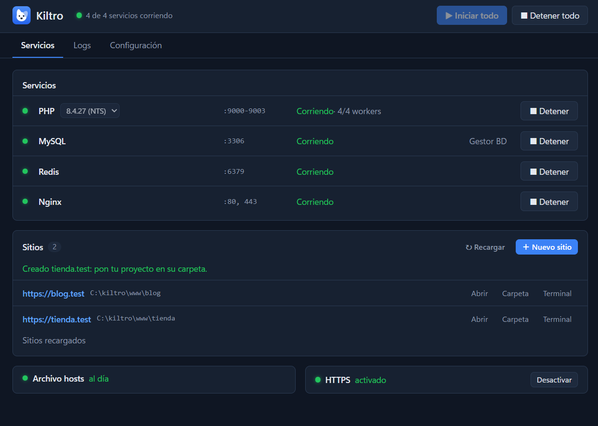
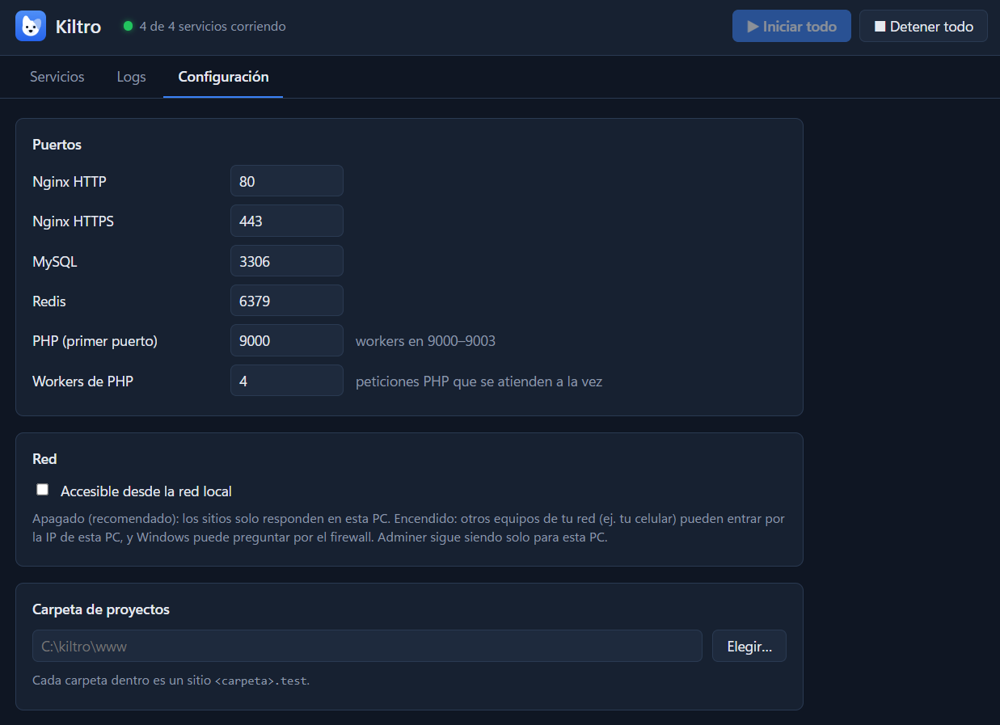
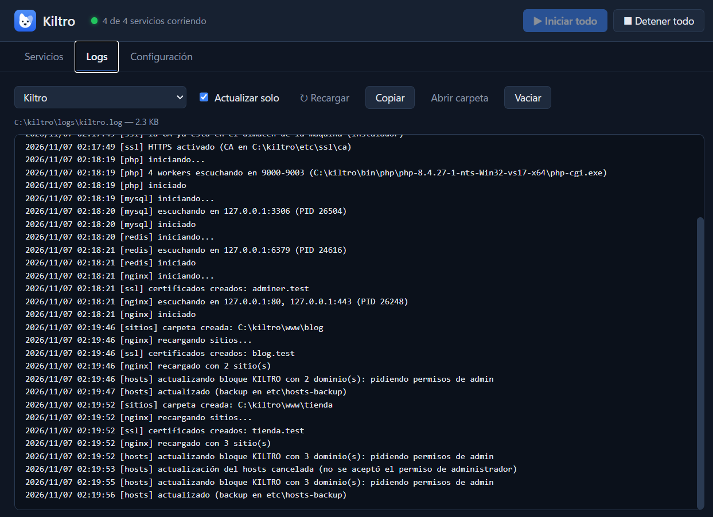
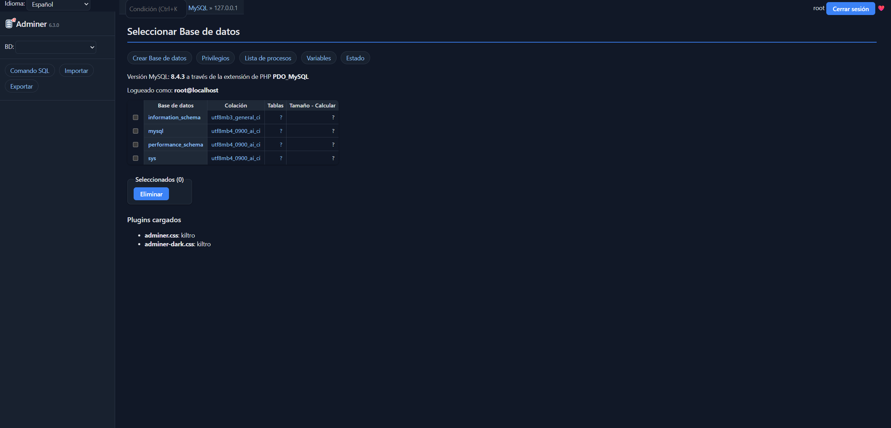

<p align="center">
  
</p>

<h1 align="center">Kiltro</h1>

<p align="center">
  <strong>Tu entorno PHP local en Windows: liviano, portable y sin complicaciones.</strong><br>
  Nginx, PHP, MySQL y Redis listos en un clic, con un sitio <code>https://proyecto.test</code> por cada carpeta.
</p>

<p align="center">
  <a href="https://github.com/Cashupin/kiltro/releases/latest"></a>
  
  <a href="LICENSE"></a>
</p>

<p align="center">
  <a href="https://github.com/Cashupin/kiltro/releases/latest"><strong>Descargar</strong></a> ·
  <a href="#primeros-pasos">Primeros pasos</a> ·
  <a href="#preguntas-frecuentes">Preguntas frecuentes</a> ·
  <a href="README.en.md">English</a>
</p>

<p align="center">
  
</p>

---

## ¿Por qué Kiltro?

Un *quiltro* es un perro mestizo chileno: sin pedigrí, pero leal, liviano y que se las
arregla en cualquier parte. Kiltro es eso para tu PC.

- **Liviano de verdad.** Sin Docker, sin máquinas virtuales y sin servicios de Windows
  instalados. Los servicios corren solo cuando los inicias y se apagan con Kiltro. Anda bien
  en PCs con poca RAM.
- **Un sitio por carpeta.** Creas `www\mi-tienda` y ya tienes `http://mi-tienda.test`. Detecta
  proyectos Laravel y los sirve desde `public/`.
- **HTTPS local con un clic.** Certificados válidos para `https://*.test`, con candado verde
  en Chrome, Edge y Firefox.
- **Cambia de versión de PHP** desde un desplegable. Cada versión con su propio `php.ini`.
- **`php` y `composer` en cualquier terminal**, siempre con la versión elegida en Kiltro.
- **Gestor de bases de datos incluido** (Adminer, con tema propio) a un clic.
- **No corre como administrador.** Solo pide permiso (UAC) para actualizar el archivo
  `hosts` cuando cambian tus dominios.
- **Portable.** Todo vive en una carpeta: configuración, bases de datos, logs y proyectos.
- **En español e inglés**, según el idioma de tu Windows (se cambia en Configuración).
- **Libre y abierto** (GPL-3.0).

## Qué incluye

| | Versión |
|---|---|
| Nginx | 1.30.4 |
| PHP (NTS) | 8.4.27 — puedes agregar más versiones |
| MySQL Community | 8.4.3 LTS |
| Redis (port para Windows) | 5.0.14.1 |
| Composer | 2.10.2 |
| Adminer | 6.3.0 |
| mkcert (HTTPS local) | 1.4.4 |

Sin modificar y con sus licencias originales (ver [THIRD-PARTY-NOTICES.md](THIRD-PARTY-NOTICES.md)).

## Instalación

1. Descarga **`kiltro-setup-<versión>.exe`** desde [Releases](https://github.com/Cashupin/kiltro/releases/latest).
2. Ejecútalo. Se instala en `C:\kiltro` (Kiltro necesita escribir en su carpeta, por eso no va
   en "Archivos de programa").
3. Abre Kiltro desde el menú Inicio.

> **¿"Windows protegió tu PC"?** El instalador todavía no tiene firma digital (cuesta dinero
> y Kiltro es un proyecto personal). Pulsa **Más información → Ejecutar de todas formas**.
> Puedes comprobar que el archivo es el original con `SHA256SUMS.txt`, que está junto a la descarga.

**Versión portable:** descarga `kiltro-portable-<versión>.zip`, descomprímelo en una carpeta
tuya (ej. `C:\kiltro`) y abre `kiltro.exe`. Funciona igual, sin instalar nada.

Requisitos: Windows 10 u 11 de 64 bits. Ocupa unos 400 MB instalado.

## Primeros pasos

1. Pulsa **▶ Iniciar todo**.
2. Pulsa **＋ Nuevo sitio**, escribe un nombre (ej. `blog`) y listo: `http://blog.test`.
3. Pon tu proyecto en esa carpeta. Por ejemplo, un Laravel nuevo: en el sitio, pulsa
   **Terminal** y escribe:

   ```bash
   composer create-project laravel/laravel .
   ```

   (Primero activa `php` y `composer` en **Configuración → php y composer en la terminal**).
4. ¿Base de datos? MySQL está en `127.0.0.1:3306`, usuario `root` sin contraseña (lo que
   espera el `.env` de Laravel). El botón **Gestor BD** abre Adminer.
5. ¿HTTPS? En la tarjeta HTTPS pulsa **Activar** y usa `https://blog.test`.

<p align="center">
  
  
</p>
<p align="center">
  
</p>

## Preguntas frecuentes

<details>
<summary><strong>¿Por qué me pide permiso de administrador?</strong></summary>

Para que `blog.test` funcione, Kiltro agrega una línea al archivo `hosts` de Windows, y ese
archivo solo se puede modificar como administrador. Solo pasa cuando cambian tus sitios
(creas, borras o renombras uno). Kiltro modifica únicamente su propio bloque
(`# KILTRO START` … `# KILTRO END`) y guarda un respaldo antes de cada cambio. Kiltro en sí
nunca corre como administrador.
</details>

<details>
<summary><strong>¿Dónde quedan mis proyectos y bases de datos?</strong></summary>

En la carpeta de Kiltro (`C:\kiltro`): proyectos en `www\`, bases de datos en `data\`, logs en
`logs\`. La carpeta de proyectos se puede cambiar en **Configuración**. Al actualizar o
desinstalar Kiltro, `www\` y `data\` se conservan (salvo que marques lo contrario).
</details>

<details>
<summary><strong>¿Cómo uso otra versión de PHP?</strong></summary>

Descarga el zip de la versión desde [windows.php.net](https://windows.php.net/download/)
(se recomienda la build **NTS x64**) y descomprímelo en `C:\kiltro\bin\php\php-<versión>\`.
Aparece en el desplegable de PHP. Pronto habrá un descargador dentro de Kiltro.
</details>

<details>
<summary><strong>¿Puedo ver mis sitios desde el celular?</strong></summary>

Sí: en **Configuración** activa "Accesible desde la red local" y entra con la IP de tu PC.
Viene apagado para que nadie más de tu red vea tus proyectos.
</details>

<details>
<summary><strong>El puerto 80 (o 443, o 3306) está ocupado</strong></summary>

Kiltro te dice qué puerto está ocupado y, si puede, qué programa lo usa (por ejemplo IIS,
Skype antiguo, VMware u otro entorno de desarrollo). Ciérralo, o cambia el puerto en
**Configuración**.
</details>

<details>
<summary><strong>¿Cómo lo desinstalo?</strong></summary>

Desde "Agregar o quitar programas" de Windows. El desinstalador quita el certificado de
HTTPS, el bloque del archivo `hosts` y la entrada del PATH. Si no marcas lo contrario,
conserva tus proyectos y bases de datos.
</details>

## Contribuir

¿Encontraste un error o tienes una idea? Abre un [issue](https://github.com/Cashupin/kiltro/issues).
Para compilar Kiltro o entender cómo funciona por dentro, ve la
[guía técnica](docs/DEVELOPMENT.md).

Hecho con [Wails](https://wails.io) (Go + Svelte).

## Licencia

Kiltro es software libre bajo la licencia [GPL-3.0](LICENSE). Copyright © 2026 Cashupin.

Puedes usarlo, estudiarlo, modificarlo y compartirlo. Si distribuyes una versión modificada,
también tiene que ser libre (GPL-3.0) e incluir su código fuente.
